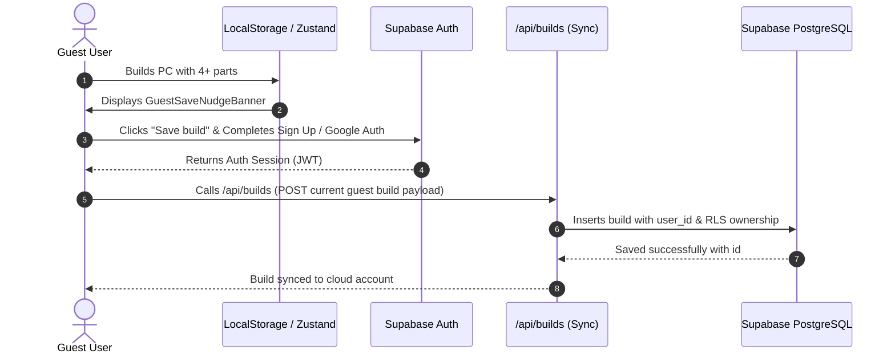
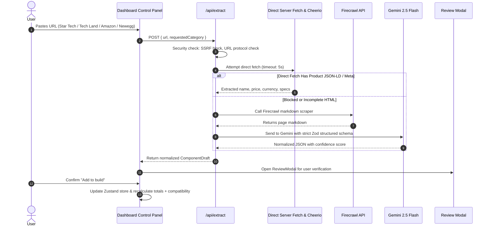

# AnyLink PC Builder — Technical Architecture & Implementation Plan (PLAN.md)

**Project:** AnyLink PC Builder  
**Working Directory:** `a:\AnyLink PC Builder\Website`  
**Stage:** Stage 0 Deliverable & Master Specification  
**Design System:** Monochrome Glassmorphism (Strict Black & White, Apple visionOS + Linear density)  

---

## 1. Route Map (Next.js App Router)

| Route | Type | Description | Access |
|---|---|---|---|
| `/` | Page (Client/Server) | **Builder Dashboard**: Hero URL ingest input, sticky summary panel, currency selector, theme toggle, and component slot list. For first-time visitors, displays empty dashboard first-time guidance. | Public (Guest & Authenticated) |
| `/login` | Page | **Auth Card (Log In Tab active)**: Frosted glass card with Google OAuth, magic link, email/password form, "Continue as guest" escape hatch. | Public |
| `/signup` | Page | **Auth Card (Sign Up Tab active)**: Account registration with guest build preservation pledge ("Your guest build will be saved to your account"). | Public |
| `/my-builds` | Page | **My Builds List**: Grid of saved user builds with build name, component count, estimated total, last updated timestamp, load action, share action, and delete action. | Authenticated (Redirects to `/login` if guest) |
| `/b/[shareId]` | Page | **Public Read-Only Build View**: Clean public view of a shared build. Shows full component breakdown, specs, converted prices, and "Copy to my builder" button. | Public (Read-only) |
| `/preview/components` | Page (Dev) | **Design System Component Preview**: Stage 1 checkpoint page rendering all buttons, glass cards, inputs, popovers, chips, modals, toasts, and skeletons in both Dark and Light themes. | Public (Dev mode) |
| `/api/extract` | API (POST) | **Multi-tier Scraping & AI Extraction Pipeline**: Validates URL, blocks SSRF, attempts direct JSON-LD/meta fetch, falls back to scraping API (Firecrawl), invokes Gemini 2.5 Flash for structured JSON extraction with Zod schema validation. | Public (Rate-limited) |
| `/api/rates` | API (GET) | **Cached Exchange Rates**: Server-cached exchange rates (base USD) supporting BDT, USD, EUR, GBP, INR, etc. with timestamp and fallback handling. | Public |
| `/api/builds` | API (GET, POST) | **Build CRUD**: Fetch user's builds, create new build, update existing build. Protected with Supabase server session. | Authenticated |
| `/api/builds/[id]` | API (GET, PATCH, DELETE) | **Individual Build Operations**: Rename, update components, delete. | Owner only |
| `/api/builds/share` | API (POST) | **Share Link Generator**: Generates or retrieves 7-character nanoid/short code for a build. | Owner only |
| `/export/pdf` | Route Handler (GET) / Client View | **Printable A4 Spec Sheet**: Light theme A4 printable bill of materials, formatted per the demo design with `window.print()` / PDF download support. | Public |

---

## 2. Component Inventory

### 2.1 Primitives & Design System (`components/ui/`)
1. **GlassCard (`components/ui/glass-card.tsx`)**:
   - Translucent surface (`rgba(255,255,255,0.05)` dark / `rgba(255,255,255,0.55)` light), `backdrop-blur-2xl`, `1px` subtle perimeter border (`white/10` dark / `black/8` light), inset specular top highlight (`inset 0 1px 0 0 rgba(255,255,255,0.15)`).
   - Radius: Container level (`rounded-[20px]`).
2. **Button (`components/ui/button.tsx`)**:
   - Variants:
     - `solid` (Primary): Solid white fill with black text (dark theme) / solid black fill with white text (light theme). Height 40px, `rounded-xl`, Inter 14px font-medium.
     - `glass` (Secondary): Translucent fill with 1px border and inset top highlight.
     - `ghost`: Transparent background, muted text, subtle hover highlight.
     - `destructive`: Ghost button with subtle monochrome trash/warning outline.
3. **Input (`components/ui/input.tsx`)**:
   - Height 40px, `rounded-xl`, subtle glass fill (`rgba(255,255,255,0.03)`), 1px border. Focus: border opacity boost + inner top specular line. No colored ring. JetBrains Mono for numbers/prices, Inter for text.
4. **Select / Popover (`components/ui/select.tsx`, `components/ui/popover.tsx`)**:
   - Floating elevated glass layer (`z-20`, `blur-3xl`, 1px border, deeper drop shadow).
5. **Chip / Badge (`components/ui/chip.tsx`)**:
   - Pill radius (`rounded-full`), JetBrains Mono 11px uppercase tracking `0.05em`. Monochrome glyph indicators (● active, ○ idle, ⊘ warning/flag).
6. **Modal & Bottom Sheet (`components/ui/modal.tsx`, `components/ui/sheet.tsx`)**:
   - Desktop: Centered floating glass dialog with blurred background backdrop.
   - Mobile: Slides up from bottom as a bottom sheet.
7. **Toast (`components/ui/toast.tsx`)**:
   - Floating monochrome glass pill at bottom center (e.g., "GPU added · Undo") with auto-dismiss and undo callback.
8. **Skeleton (`components/ui/skeleton.tsx`)**:
   - Glass shimmer card with gentle sweeping gradient opacity.
9. **Tooltip (`components/ui/tooltip.tsx`)**:
   - One-time introductory hint badge with pointer arrow.
10. **BackgroundOrbs (`components/ui/background-orbs.tsx`)**:
    - Fixed non-interactive radial blurred white/gray glow circles (5%–8% opacity in dark theme, 120px–180px blur) to provide refractive substance for glassmorphism.

### 2.2 Shell & Navigation (`components/layout/`)
1. **TopBar (`components/layout/top-bar.tsx`)**:
   - Logo, build name editor with inline pencil icon, active currency selector dropdown (BDT, USD, EUR, GBP, INR, etc.), theme toggle (sun/moon), and account menu / "Continue as guest" indicator.
2. **Sidebar (`components/layout/sidebar.tsx`)**:
   - Slim desktop navigation: Dashboard, My Builds, and quick build count indicator. Collapsible on smaller viewports.
3. **MobileBottomBar (`components/layout/mobile-bottom-bar.tsx`)**:
   - Pinned 390px mobile footer bar with quick URL input, paste icon button, and compact running total badge.

### 2.3 Dashboard & Builder (`components/builder/`)
1. **ControlPanel (`components/builder/control-panel.tsx`)**:
   - Hero URL input with category auto-detect / select dropdown, live favicon and domain pill preview, "Analyze" action button, inline status line, and scanning progress checklist.
2. **BuildSummaryCard (`components/builder/build-summary-card.tsx`)**:
   - Total converted price (large JetBrains Mono), currency symbol, component count ("X of 9+ parts"), delta indicator (`+ $X.XX` on addition), and compatibility status chip ("Looking good" / "X things to check").
3. **CompatibilityPanel (`components/builder/compatibility-panel.tsx`)**:
   - Expandable glass panel appearing when advisories exist. Lists strict physical/electrical checks (Wattage, Socket match, RAM generation, GPU length vs Case clearance). Each row includes a "View part" button that smoothly scrolls to the slot.
4. **SlotList (`components/builder/slot-list.tsx`)**:
   - Renders 9 core component slots plus dynamic secondary slots (Multiple Storage drives, multiple RAM kits).
5. **SlotCardEmpty (`components/builder/slot-card-empty.tsx`)**:
   - Dashed translucent card with category line icon, slot label, and "Paste a link to add" helper. Clicking syncs the control panel category dropdown.
6. **SlotCardFilled (`components/builder/slot-card-filled.tsx`)**:
   - Solid glass card with 64px component image, product name, spec chips, merchant favicon + domain pill, right-aligned mono price, warning badge if compatibility advisory applies, and hover edit/delete actions.
7. **SlotCardScanning (`components/builder/slot-card-scanning.tsx`)**:
   - Skeleton card with active shimmer animation during extraction.
8. **AddSlotButton (`components/builder/add-slot-button.tsx`)**:
   - Button to dynamically add an extra Storage drive (SSD #2, SSD #3) or Memory kit (RAM 2).

### 2.4 Modals & Workflows (`components/modals/`)
1. **ReviewModal (`components/modals/review-modal.tsx`)**:
   - Floating glass modal (or mobile bottom sheet) displaying 160px product image, domain pill, editable title, category selector, price input, currency dropdown, spec chips, low-confidence warning field (`outline: 1px dashed`), and "Add to build" confirmation.
2. **ManualEntryModal (`components/modals/manual-entry-modal.tsx`)**:
   - Fallback modal when link extraction fails, allowing the user to manually enter name, price, currency, category, store link, and specifications.
3. **ExportModal (`components/modals/export-modal.tsx`)**:
   - Left: Live document preview of build summary. Right: 5 output channels (Share link with account lock for guests, PDF document, CSV, Social Image, Copy Text).
4. **ExportSuccessModal (`components/modals/export-success-modal.tsx`)**:
   - Confirmation with checkmark, generated file name / short URL (`anylink.app/b/xxxxxx`), "Copy link" button with "Copied ✓" state, and "Download again" button.
5. **GuestSaveNudgeBanner (`components/modals/guest-save-nudge.tsx`)**:
   - Non-blocking bottom banner appearing when guest has 4+ parts added, prompting them to save to a free account.
6. **QuickAuthModal (`components/modals/quick-auth-modal.tsx`)**:
   - Compact sign-up/login modal triggered by the nudge banner, promising seamless migration of the local build.

---

## 3. Data Flow & State Management

### 3.1 State Architecture (Zustand + Local Storage)
- **Store:** `useBuildStore` (`lib/store/build-store.ts`)
  - **State:**
    - `id`: string (uuid)
    - `name`: string (e.g., "My Dream Rig")
    - `components`: `Record<string, ComponentItem>` (keyed by slot id)
    - `currency`: SupportedCurrency (default: BDT for BD region detection or USD, persisted in `localStorage`)
    - `selectedSlotCategory`: ComponentCategory | "auto"
    - `isScanning`: boolean
    - `scanningProgress`: number (0, 1, 2, 3)
    - `lastAddedSlotId`: string | null (for undo toast)
    - `previousState`: BuildSnapshot | null (for 1-click Undo)
    - `compatibilityAdvisories`: CompatibilityAdvisory[]
  - **Actions:**
    - `addComponent(slotId, component)`
    - `updateComponent(slotId, updates)`
    - `removeComponent(slotId)`
    - `undoLastAction()`
    - `setCurrency(currency)`
    - `setBuildName(name)`
    - `clearBuild()`
    - `loadBuild(buildData)`
    - `addExtraSlot(category: "storage" | "memory")`
    - `removeExtraSlot(slotId)`

### 3.2 Guest-to-Account Migration Flow


### 3.3 Extraction Pipeline Flow


---

## 4. Supabase Database Schema & RLS Policies

```sql
-- Enable UUID extension
create extension if not exists "uuid-ossp";

-- 1. Profiles Table
create table public.profiles (
  id uuid references auth.users on delete cascade primary key,
  email text,
  full_name text,
  preferred_currency text default 'BDT',
  theme text default 'dark',
  created_at timestamp with time zone default timezone('utc'::text, now()) not null,
  updated_at timestamp with time zone default timezone('utc'::text, now()) not null
);

-- 2. Builds Table
create table public.builds (
  id uuid default uuid_generate_v4() primary key,
  user_id uuid references public.profiles(id) on delete cascade,
  name text default 'Untitled Build' not null,
  share_code text unique, -- 7-char short link id
  is_public boolean default false not null,
  components jsonb default '[]'::jsonb not null,
  created_at timestamp with time zone default timezone('utc'::text, now()) not null,
  updated_at timestamp with time zone default timezone('utc'::text, now()) not null
);

-- Indexes
create index builds_user_id_idx on public.builds(user_id);
create index builds_share_code_idx on public.builds(share_code);

-- Row Level Security (RLS)
alter table public.profiles enable row level security;
alter table public.builds enable row level security;

-- Profiles Policies
create policy "Users can view their own profile"
  on public.profiles for select
  using (auth.uid() = id);

create policy "Users can update their own profile"
  on public.profiles for update
  using (auth.uid() = id);

-- Builds Policies
create policy "Users can view their own builds"
  on public.builds for select
  using (auth.uid() = user_id);

create policy "Anyone can view public shared builds"
  on public.builds for select
  using (is_public = true or share_code is not null);

create policy "Users can insert their own builds"
  on public.builds for insert
  with check (auth.uid() = user_id);

create policy "Users can update their own builds"
  on public.builds for update
  using (auth.uid() = user_id);

create policy "Users can delete their own builds"
  on public.builds for delete
  using (auth.uid() = user_id);
```

---

## 5. Environment Variables Specification

File: `.env.example` (Committed) and `.env.local` (Local development only)

```env
# ----------------------------------------------------
# ANYLINK PC BUILDER - ENVIRONMENT CONFIGURATION
# ----------------------------------------------------

# --- Supabase Database & Auth ---
NEXT_PUBLIC_SUPABASE_URL=https://placeholder-project.supabase.co
NEXT_PUBLIC_SUPABASE_ANON_KEY=placeholder-anon-key
SUPABASE_SERVICE_ROLE_KEY=placeholder-service-role-key

# --- AI Extraction (Gemini API Free Tier) ---
# Obtain from Google AI Studio: https://aistudio.google.com/
GEMINI_API_KEY=placeholder-gemini-api-key

# --- Fallback Web Scraping (Firecrawl API Free Tier) ---
# Obtain from Firecrawl: https://firecrawl.dev/
FIRECRAWL_API_KEY=placeholder-firecrawl-api-key

# --- Exchange Rates API ---
# Free tier from https://www.exchangerate-api.com/ (1,500 req/month)
EXCHANGE_RATE_API_KEY=placeholder-exchangerate-api-key

# --- Application Base URL ---
NEXT_PUBLIC_APP_URL=http://localhost:3000
```

---

## 6. Screen-to-Component Mapping (All 14 Flows)

| Flow # | Screen Name in `Demo_Design` | Implementation Component(s) | Key Functional Features |
|---|---|---|---|
| **Flow 1** | `anylink_landing_auth_choice` | `app/page.tsx` + `components/auth/landing-auth-card.tsx` | Minimal hero, simulated URL preview, "Continue as guest" (solid white), "Log in" (ghost), "Create account" (ghost). |
| **Flow 2a** | `anylink_log_in` | `app/login/page.tsx` + `components/auth/auth-card.tsx` | Segmented switch [Log In \| Sign Up], Google OAuth, email/password, magic link toggle, "Continue as guest". |
| **Flow 2b** | `anylink_sign_up` | `app/signup/page.tsx` + `components/auth/auth-card.tsx` | Sign Up tab active, name field, guest build preservation assurance badge. |
| **Flow 3** | `anylink_empty_dashboard_first_time_guide` | `components/builder/dashboard-view.tsx` + `SlotCardEmpty` | Left sticky control panel, one-time guidance tooltip, 9 dashed slot cards, $0.00 total, "Nothing to check yet". |
| **Flow 4** | Select component category | `components/builder/control-panel.tsx` + `SlotList` | Slot click updates dropdown from "Auto-detect" to category (e.g. "GPU"), input placeholder updates, linked focus indicator. |
| **Flow 5** | Paste URL | `components/builder/url-input.tsx` | Truncated URL display, store domain & favicon pill (`newegg.com`, `startech.com.bd`), clear button, solid "Analyze" button. |
| **Flow 6** | Scanning state | `components/builder/scanning-progress.tsx` + `SlotCardScanning` | 3-step checklist (Fetching page ✓, Reading product details ⟳, Extracting specs), shimmering target slot card, Cancel button. |
| **Flow 7** | `anylink_review_verify_component` | `components/modals/review-modal.tsx` | 160px image, domain badge, editable title, category selector, price in JetBrains Mono + currency dropdown, spec chips, dashed low-confidence alert box ("Check this"). |
| **Flow 8** | `anylink_component_added_active_build` | `SlotCardFilled` + `components/ui/toast.tsx` | Filled glass card with thumbnail, specs, mono price, edit/delete icons. Bottom toast "GPU added · Undo". Converted total updates with delta badge. |
| **Flow 9** | `anylink_link_ingestion_error` | `components/builder/control-panel-error.tsx` + `ManualEntryModal` | Glass error card: "We couldn't read this page", solid "Try again", ghost "Enter details manually", URL pill with edit icon. |
| **Flow 10** | `anylink_mid_build_compatibility_warning` | `components/builder/compatibility-panel.tsx` | Collapsible glass advisory panel ("2 things to check"), real rule checks (PSU wattage, GPU clearance), warning badges on affected slots, "View part" scroll links. |
| **Flow 11** | `anylink_flow_11_export_build` | `components/modals/export-modal.tsx` | Left: small glass document summary preview. Right: 5 options (Share link [locked for guests], PDF, CSV, Image, Copy text). Editable build title. |
| **Flow 12** | `anylink_flow_12_download_share_confirmation` | `components/modals/export-success-modal.tsx` | Checkmark, file name, download button, short link input with "Copy link" (turns to "Copied ✓"), secondary export buttons. |
| **Flow 13** | `anylink_flow_13_guest_save_nudge_quick_registration` | `components/modals/guest-save-nudge.tsx` | Non-blocking bottom banner when guest adds 4+ parts, "Save build" triggers compact modal with Google/email options. |
| **Flow 14** | `anylink_flow_14_mobile_dashboard_390px` | `components/layout/mobile-dashboard.tsx` | 390px responsive viewport, pinned bottom glass URL bar, compact total chip, scanning and review modal render as bottom sheets. |
| **PDF Follow-up**| `anylink_a4_printable_build_specification_light_theme` | `app/export/pdf/page.tsx` + print styling | Pure light theme A4 print layout (black on white, no glass), manifest header, bill of materials table, store links, generation date. |

---

## 7. Component Slots Specification (9 Standard + Dynamic Multi-slots)

The application models the following slots:
1. `cpu`: Processor (CPU) — Socket, TDP, Cores, Frequency
2. `cooler`: CPU Cooler — Supported Sockets, Max TDP, Radiator Size
3. `motherboard`: Motherboard — Socket, Chipset, Form Factor, Memory Type (DDR4/DDR5), Max RAM
4. `memory`: Memory (RAM) — Kit Size, Type (DDR4/DDR5), Speed, Modules (supports `+ Add RAM Kit` for additional kits)
5. `storage`: Primary Storage — Capacity, Interface (M.2 NVMe / SATA), Form Factor (supports `+ Add Storage Drive` for multiple SSDs/HDDs)
6. `gpu`: Video Card (GPU) — Chipset, VRAM, Length (mm), TDP (W)
7. `psu`: Power Supply — Wattage, Efficiency Rating, Modular type
8. `case`: Case (Chassis) — Form Factor, Max GPU Length clearance (mm), Max Cooler Height (mm)
9. `fans`: Case Fans — Size (120mm/140mm), Quantity, PWM

---

## 8. Verification & Checkpoint Criteria for Stage 0
- [x] All 14 flows from `Demo_Design` mapped to concrete React components.
- [x] Route map defined according to Next.js App Router conventions.
- [x] Supabase schema, indexes, and RLS policies specified for user isolation and public sharing.
- [x] Environment variable placeholders and documentation plan outlined.
- [x] Multi-slot support for Storage and Memory incorporated into the architecture.
- [x] Regional Bangladesh store support (Star Tech, Tech Land, Ryans) + International retailers architected into extraction pipeline.

